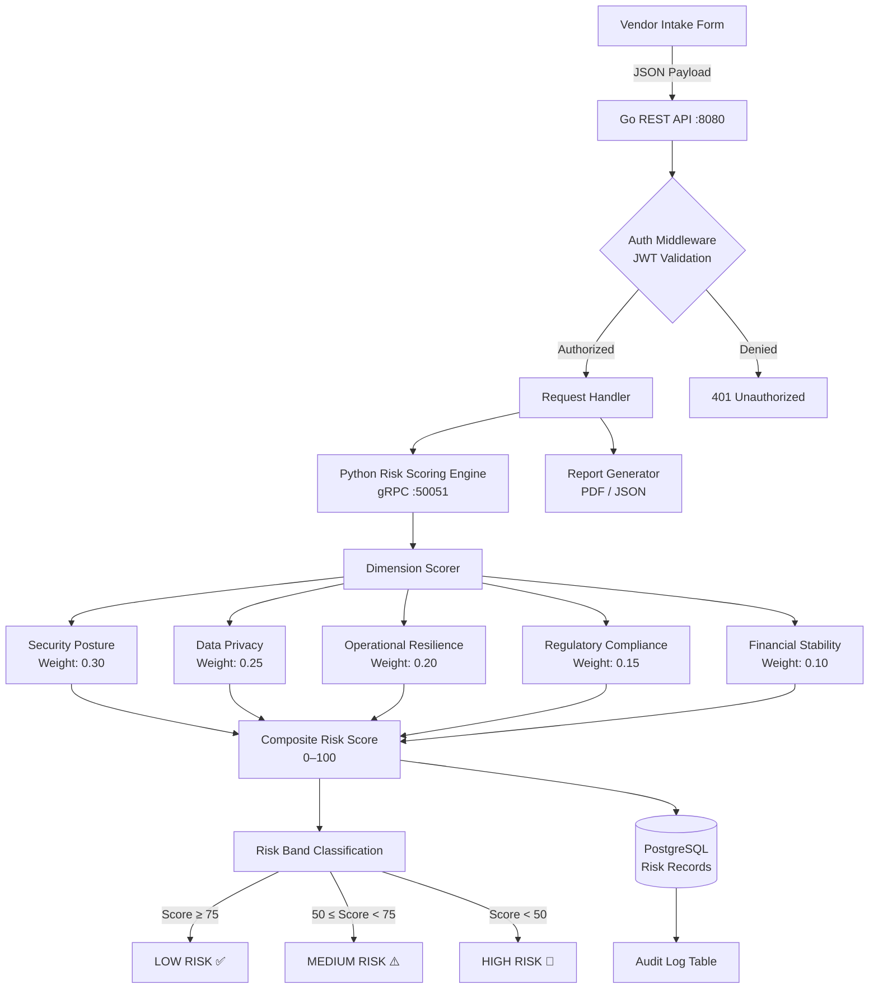
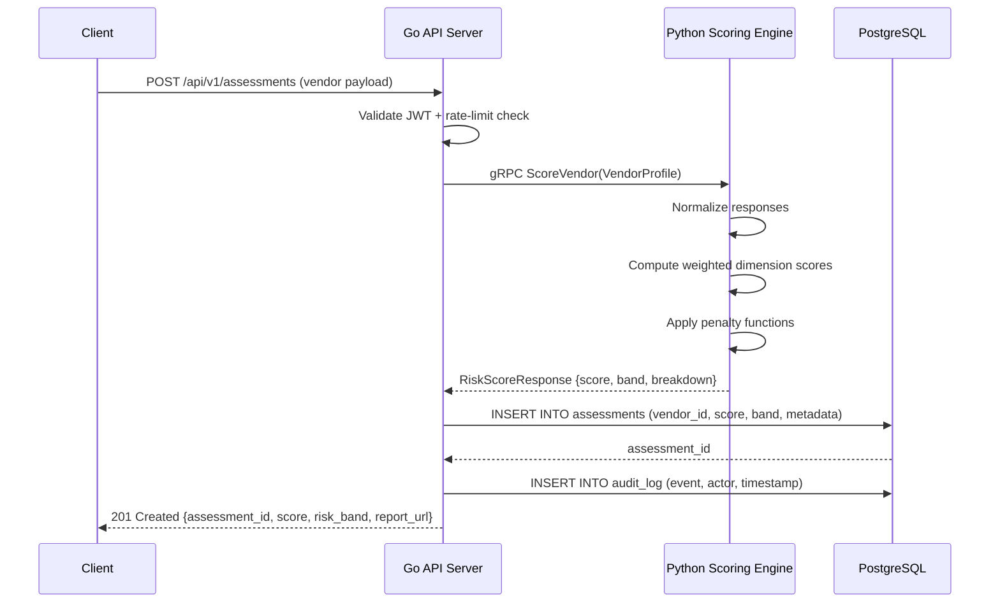

# GRC Vendor Risk Engine

[](https://python.org)
[](https://go.dev)
[](https://postgresql.org)
[](LICENSE)

A **governance, risk, and compliance (GRC) vendor risk scoring platform** that automates third-party risk assessments using a multi-dimensional weighted scoring model. Designed for organizations operating under frameworks such as **NIST CSF 2.0**, **ISO 27001:2022**, and **NDPA** (Nigeria Data Protection Act) or **Kenya DPA** — particularly relevant in extraterritorial data processing contexts.

---

## Architecture



---

## Risk Scoring Model

The composite score **S** is computed as a weighted linear combination of normalized dimension scores:

$$S = \sum_{i=1}^{n} w_i \cdot d_i \quad \text{subject to} \quad \sum_{i=1}^{n} w_i = 1, \quad d_i \in [0, 100]$$

Each dimension $d_i$ is derived from sub-criterion responses mapped through a **non-linear penalty function** to capture asymmetric risk exposure:

$$d_i = 100 \cdot \left(1 - \prod_{j=1}^{m} (1 - p_{ij} \cdot c_{ij})\right)^{-1}$$

where $p_{ij}$ is the probability weight and $c_{ij}$ is the criticality flag for sub-criterion $j$ within dimension $i$.

---

## Data Flow



---

## Tech Stack

| Layer | Technology | Responsibility |
|---|---|---|
| **API Server** | Go 1.22 + `net/http` | REST routing, JWT auth, rate limiting |
| **Scoring Engine** | Python 3.11 + gRPC | Multi-dimensional risk computation |
| **Persistence** | PostgreSQL 16 | Vendor records, audit trails, history |
| **IPC** | gRPC + Protobuf | Low-latency service communication |
| **Auth** | JWT (RS256) | Stateless bearer token validation |

---

## Project Structure

```
grc-vendor-risk-engine/
├── api/                   # Go REST API server
│   ├── main.go            # Entry point, server bootstrap
│   └── handlers.go        # HTTP route handlers + middleware
├── risk_engine/           # Python gRPC scoring microservice
│   ├── scorer.py          # Core risk computation logic
│   └── models.py          # Pydantic domain models + validators
├── db/                    # PostgreSQL schema and queries
│   ├── schema.sql         # DDL — tables, indexes, constraints
│   └── queries.sql        # Parameterized application queries
├── proto/
│   └── risk.proto         # Protobuf service definition
└── README.md
```

---

## Getting Started

### Prerequisites
- Go ≥ 1.22
- Python ≥ 3.11
- PostgreSQL ≥ 16
- `protoc` with `grpc` plugins

### Setup

```bash
# 1. Start PostgreSQL and apply schema
psql -U postgres -d vendorrisk -f db/schema.sql

# 2. Launch Python scoring engine
pip install -r risk_engine/requirements.txt
python risk_engine/scorer.py

# 3. Launch Go API server
cd api && go run . -port 8080 -scoring-addr localhost:50051
```

### Example Request

```bash
curl -X POST http://localhost:8080/api/v1/assessments \
  -H "Authorization: Bearer <token>" \
  -H "Content-Type: application/json" \
  -d '{
    "vendor_id": "vendor-abc-123",
    "security": { "mfa_enforced": true, "pen_tested": true, "vuln_sla_days": 14 },
    "privacy": { "ndpa_compliant": true, "dpa_appointed": true, "cross_border_transfers": false },
    "resilience": { "rto_hours": 4, "rpo_hours": 1, "dr_tested": true },
    "compliance": { "iso27001": true, "soc2_type2": false },
    "financial": { "years_operating": 7, "public_company": false }
  }'
```

---

## Compliance Frameworks Supported

- **NIST CSF 2.0** — Govern, Identify, Protect, Detect, Respond, Recover
- **ISO/IEC 27001:2022** — Annex A control mapping
- **NDPA (Nigeria)** — Article 24 data processor obligations
- **Kenya Data Protection Act, 2019** — Section 41 extraterritorial transfers

---

## License

MIT © Primel Jayawardana
